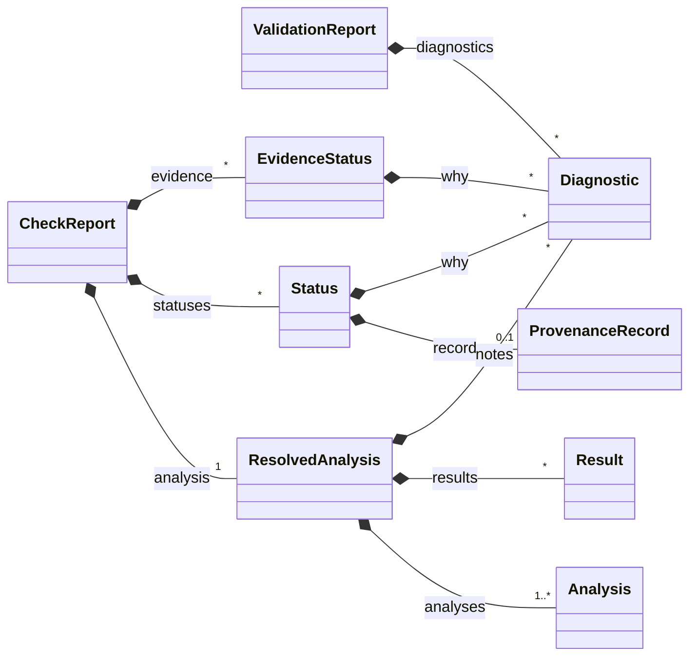
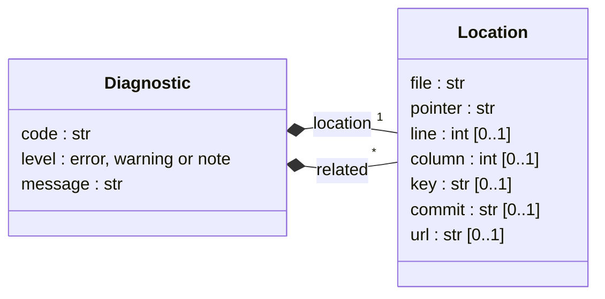
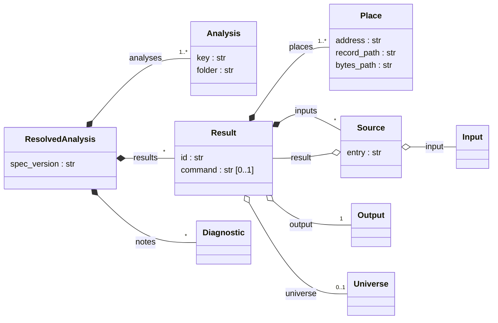
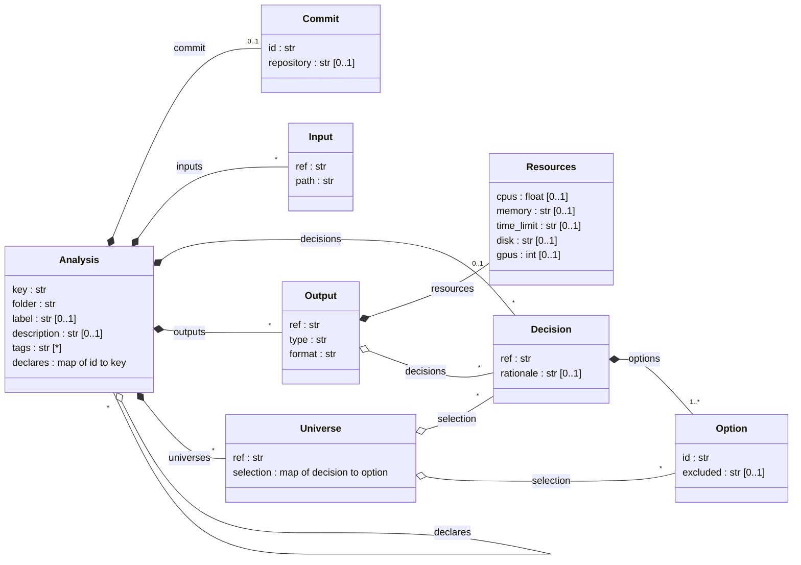
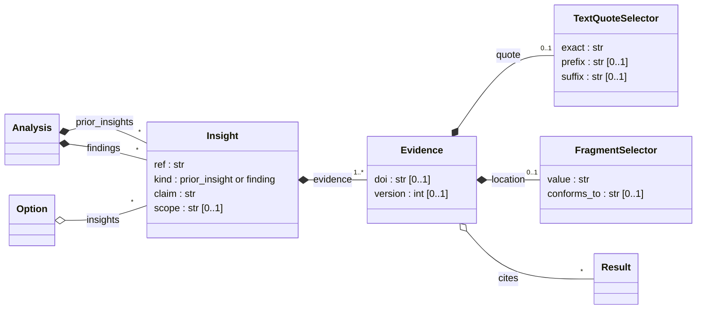
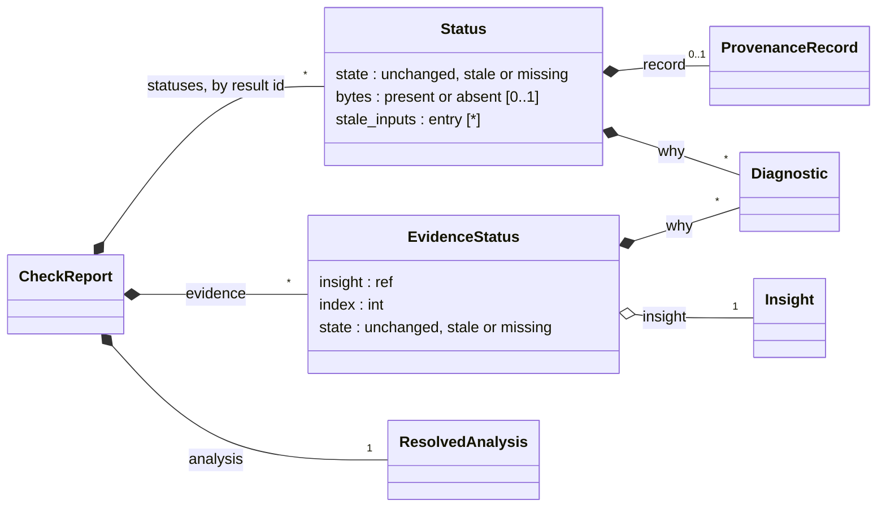
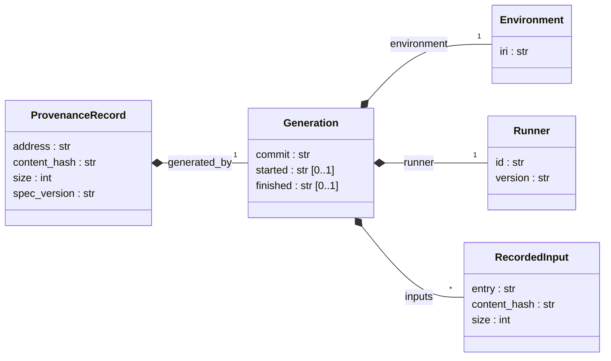
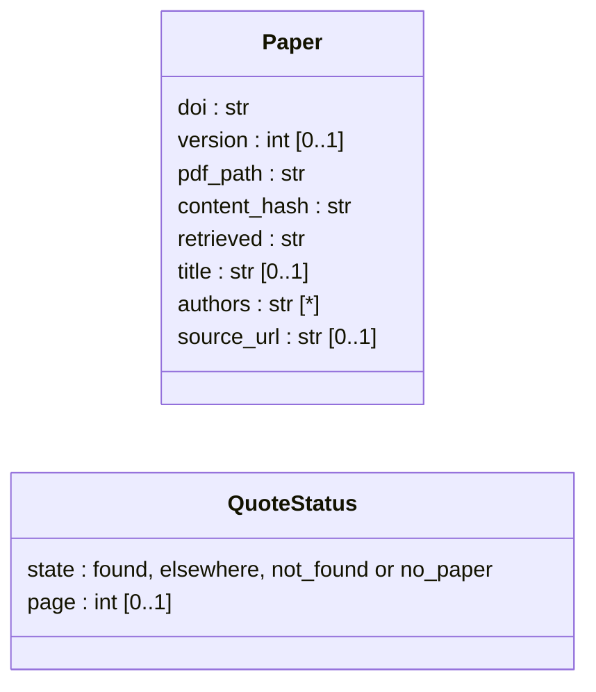

# Data model

The data model is what the functions of [`astra.api`](api.md) return, and what a runner hands
back. It is defined in
[`src/astra/model/`](https://github.com/astra-project/astra-tools/tree/main/src/astra/model),
a file for each thing a function returns, and those files hold nothing else.

| File | Classes | Where they come from |
|---|---|---|
| `validation_report.py` | [`ValidationReport`](#validationreport) | `validate` returns it |
| `resolved_analysis.py` | [`ResolvedAnalysis`](#resolvedanalysis) and the classes it is made of | `resolve` returns it |
| `check_report.py` | [`CheckReport`](#checkreport), [`Status`](#status), [`EvidenceStatus`](#evidencestatus) | `check` returns it |
| `provenance_record.py` | [`ProvenanceRecord`](#provenancerecord), [`Generation`](#generation) and its parts | a runner gives `write_records` a `Generation`; a `Status` holds the record |
| `diagnostic.py` | [`Diagnostic`](#diagnostic), [`Location`](#location) | the reports hold them |
| `paper.py` | [`Paper`](#paper), [`QuoteStatus`](#quotestatus) | the paper functions return them |

Every class is imported from `astra.api`.

## Conventions

- **Plain data.** Every class is a frozen dataclass that holds what JSON holds: text, numbers,
  true and false, lists and maps. In Python a list is a `tuple`, and a map a read-only
  mapping.
- **A reference is an id, never an object.** Where one element names another, it holds the
  other's id as text, and a reader looks it up.
- **Each fact once.** What a reader gets by following a reference isn't repeated.
- **One JSON form.** Each class writes as a JSON object that holds every field under its name.
  An optional field is left out where it has no value, and is never `null`. A list or a map is
  always there, empty or not. `ValidationReport`, `ResolvedAnalysis` and `CheckReport` have a
  `to_json()` method that gives it.

In the tables below, *optional* marks a field that can have no value.

The diagrams are UML class diagrams. A filled diamond is on a class that holds another; a
hollow diamond is on a class that refers to another by its ref or id. The number beside a class
says how many, and `[0..1]` after a field marks an optional one, `[*]` a list.

## Overview

The three reports, and what they share.



## Diagnostics

A diagnostic is a rule broken, or a note, and where. Its code is a rule's in the
specification's [table of rules](https://astra-spec.org/0.1/specification/#rules), or one of
astra-tools' own.



### `Diagnostic`

| Field | Type | Meaning |
|---|---|---|
| `code` | `str` | The rule's code, such as `UNRESOLVED_ADDRESS` |
| `level` | `str` | `error` for a `MUST` broken, `warning` for a `SHOULD`, `note` for what breaks no rule |
| `message` | `str` | What is wrong, and where it helps, what to do |
| `location` | [`Location`](#location) | Where it is |
| `related` | list of [`Location`](#location) | Other places it concerns |

### `Location`

| Field | Type | Meaning |
|---|---|---|
| `file` | `str` | The document's path from the top of its repository |
| `pointer` | `str` | A JSON Pointer into the document; `""` for the whole file |
| `line` | `int`, optional | The line, from 1 |
| `column` | `int`, optional | The column, from 1 |
| `key` | `str`, optional | The map key or field the diagnostic names |
| `commit` | `str`, optional | The commit the file was read at, where it wasn't read in the working tree |
| `url` | `str`, optional | The repository it came from, where that is another one |

## The validation report

### `ValidationReport`

What validating an analysis found, over its whole stack.

| Field | Type | Meaning |
|---|---|---|
| `root` | `str` | The analysis's `astra.yaml`, as a location names a file |
| `valid` | `bool` | Whether no `MUST` is broken. Warnings don't make an analysis invalid |
| `diagnostics` | list of [`Diagnostic`](#diagnostic) | Each rule broken: the working tree's files first, then each commit's, each file in order of place |
| `unchecked` | list of `str` | The validator's codes this astra-tools doesn't check yet |

```json
{"root": "astra.yaml", "valid": true, "diagnostics": [], "unchecked": []}
```

## The resolved analysis

A resolved analysis is an analysis with every rule of the specification already applied. Two
rules decide what is in it.

It holds **what the rules give, not what they start from**. Where an `astra.yaml` writes
something only for a rule to act on, the model holds the outcome: a universe's effective
selection and no `derived_from`, what each entry of an output's `inputs` reads and no switch,
a command as it runs and no template. What a file writes for people to read stays as written:
labels, descriptions, rationales, claims, quotes.

It holds **each fact once**. A result carries its places, what it reads and its command. It
carries neither the options it is made with (its output's `decisions`, looked up in its
universe's `selection`) nor the folder its recipe runs in (its output's analysis's `folder`).

### References, ids and paths

- A **ref** names an element among all the analyses of the stack: its analysis's key, the
  collection the file writes it in, and its id, joined by dots. `outputs.fit` is an output of
  the driving analysis, and `stage.decisions.method` a decision of the analysis `stage`.
- An analysis's **key** is its canonical address: the shortest chain of declarations that
  reaches it from the driving analysis, the first in alphabetical order among equals, and `""`
  for the driving analysis itself.
- A result's **id** is its address, as its record gives it (`fit#baseline`), after the key of
  the analysis it belongs to and a colon where that isn't the driving analysis
  (`stage:fit#v1`).
- Every **path** is a path from the driving analysis's folder, with `/` between folders and `.`
  for that folder itself. A file of an analysis read at a commit is in that commit's tree, from
  the top of the repository it is read in. A diagnostic's location isn't such a path: it names
  its file from the top of the repository.

### The analysis and its results



A source has an `input` or a `result`, never both.

### What an analysis declares



`Input`, `Decision`, `Option`, `Output` and `Universe` also have a `label`, a `description` (a
`rationale`, for a decision) and `tags`, left out of the diagram.

### Insights and evidence



### `ResolvedAnalysis`

| Field | Type | Meaning |
|---|---|---|
| `spec_version` | `str` | The driving analysis's `spec_version` |
| `analyses` | list of [`Analysis`](#analysis) | The driving analysis, then each it declares, directly or not, by key |
| `results` | list of [`Result`](#result) | The planned results, each after every result it reads |
| `notes` | list of [`Diagnostic`](#diagnostic) | What an author may want to tidy, which breaks no rule |

The notes are `FALLBACK_PIN`, `UNPLANNED_OUTPUT` and `NOT_BUILT`, at the level `note`, and the
runner rule `CODE_OUTSIDE_ANALYSIS`, a warning.

### `Analysis`

One analysis of the stack, with what it declares.

| Field | Type | Meaning |
|---|---|---|
| `key` | `str` | Its canonical address; `""` for the driving analysis |
| `folder` | `str` | Its folder; `.` for the driving analysis |
| `commit` | [`Commit`](#commit), optional | The commit it is read at, where it isn't read as the driving analysis is |
| `label` | `str`, optional | |
| `description` | `str`, optional | |
| `tags` | list of `str` | |
| `declares` | map of `str` to `str` | Each declaration's id, and the key of the analysis it reaches |
| `inputs` | list of [`Input`](#input) | |
| `decisions` | list of [`Decision`](#decision) | |
| `outputs` | list of [`Output`](#output) | |
| `prior_insights` | list of [`Insight`](#insight) | |
| `findings` | list of [`Insight`](#insight) | |
| `universes` | list of [`Universe`](#universe) | |

### `Commit`

The commit an analysis is read at.

| Field | Type | Meaning |
|---|---|---|
| `id` | `str` | The commit's full id |
| `repository` | `str`, optional | The URL of another repository; none for the one that holds the driving analysis |

### `Input`

A file an analysis reads.

| Field | Type | Meaning |
|---|---|---|
| `ref` | `str` | |
| `path` | `str` | The file's path |
| `label` | `str`, optional | |
| `description` | `str`, optional | |
| `tags` | list of `str` | |

### `Decision`

A choice an analysis makes, between its options.

| Field | Type | Meaning |
|---|---|---|
| `ref` | `str` | |
| `options` | list of [`Option`](#option) | |
| `label` | `str`, optional | |
| `rationale` | `str`, optional | |
| `tags` | list of `str` | |

### `Option`

One of a decision's options.

| Field | Type | Meaning |
|---|---|---|
| `id` | `str` | |
| `label` | `str`, optional | |
| `description` | `str`, optional | |
| `tags` | list of `str` | |
| `excluded` | `str`, optional | Why it is excluded: such an option is never selected |
| `insights` | list of `str` | The prior insights that support it, by ref |

### `Output`

What an analysis declares it makes. A switch isn't one: where a file writes a switch, each
result that reads it names what it reads there, in its `inputs`.

| Field | Type | Meaning |
|---|---|---|
| `ref` | `str` | |
| `type` | `str` | `metric`, `figure`, `table`, `data` or `report` |
| `format` | `str` | The file format, such as `json` |
| `label` | `str`, optional | |
| `description` | `str`, optional | |
| `tags` | list of `str` | |
| `resources` | [`Resources`](#resources), optional | What its recipe asks for |
| `decisions` | list of `str` | The decisions it is made with, by ref |

### `Resources`

What a recipe asks for.

| Field | Type | Meaning |
|---|---|---|
| `cpus` | `float`, optional | |
| `memory` | `str`, optional | |
| `time_limit` | `str`, optional | |
| `disk` | `str`, optional | |
| `gpus` | `int`, optional | |

### `Insight`

A claim backed by evidence: what an analysis builds on, or what it concludes.

| Field | Type | Meaning |
|---|---|---|
| `ref` | `str` | |
| `kind` | `str` | `prior_insight` or `finding` |
| `claim` | `str` | |
| `evidence` | list of [`Evidence`](#evidence) | |
| `label` | `str`, optional | |
| `description` | `str`, optional | |
| `scope` | `str`, optional | |
| `tags` | list of `str` | |

### `Evidence`

What a claim rests on: a work, by its `doi`, or the results of an output, in `cites`.

| Field | Type | Meaning |
|---|---|---|
| `doi` | `str`, optional | The work's DOI |
| `version` | `int`, optional | The work's version |
| `cites` | list of `str`, optional | For evidence that cites an output, the id of each planned result it cites; empty where no result of it is planned |
| `quote` | [`TextQuoteSelector`](#textquoteselector), optional | |
| `location` | [`FragmentSelector`](#fragmentselector), optional | |

### `TextQuoteSelector`

A passage quoted exactly.

| Field | Type | Meaning |
|---|---|---|
| `exact` | `str` | The passage |
| `prefix` | `str`, optional | The text just before it |
| `suffix` | `str`, optional | The text just after it |

### `FragmentSelector`

A place in a work or an output, as a fragment identifier.

| Field | Type | Meaning |
|---|---|---|
| `value` | `str` | The fragment identifier, such as `page=6` |
| `conforms_to` | `str`, optional | The syntax it follows, as an IRI |

### `Universe`

A universe of an analysis, with the option it selects for each decision it uses.

| Field | Type | Meaning |
|---|---|---|
| `ref` | `str` | |
| `selection` | map of `str` to `str` | A decision's ref, and the id of the option selected: exactly the decisions the universe uses |
| `label` | `str`, optional | |
| `description` | `str`, optional | |
| `tags` | list of `str` | |

### `Result`

A planned result: one output, in one universe or once.

| Field | Type | Meaning |
|---|---|---|
| `id` | `str` | |
| `output` | `str` | Its output, by ref |
| `places` | list of [`Place`](#place) | Where it is kept: one place, unless its analysis is driven through two chains of declarations |
| `universe` | `str`, optional | Its universe, by ref; none for an output built once |
| `inputs` | list of [`Source`](#source) | One for each entry of its output's `inputs`, in order |
| `command` | `str`, optional | Its recipe's command as it runs, in the folder of its output's analysis, with each path relative to that folder |

A result has no `command` where it isn't built from the working tree alone: a result of an
analysis read at a commit, one whose recipe runs on a commit's files, or one that reads a file
at a commit.

### `Place`

Where one name of a result is kept.

| Field | Type | Meaning |
|---|---|---|
| `address` | `str` | The name, then `#` and the universe's id for a result built in one |
| `record_path` | `str` | Where its record goes |
| `bytes_path` | `str` | Where its bytes go |

### `Source`

What one entry of an output's `inputs` reads for a result: an input, or another result, through
any pin and the case each switch on the way takes. It has `input` or `result`, never both.

| Field | Type | Meaning |
|---|---|---|
| `entry` | `str` | The entry, as the output's `inputs` writes it |
| `input` | `str`, optional | The input it reads, by ref |
| `result` | `str`, optional | The planned result it reads, by id |

### Example

For this analysis:

```yaml
spec_version: "0.1.0"
label: Example
inputs:
  catalog: {path: data/catalog.csv}
decisions:
  method:
    options: {ols: {}, robust: {}}
outputs:
  fit:
    type: metric
    format: json
    inputs: [catalog]
    decisions: [method]
    recipe:
      command: python fit.py {inputs.catalog} {decisions.method} {output}
universes:
  baseline:
    decisions: {method: ols}
```

`resolve` gives:

```json
{
  "spec_version": "0.1.0",
  "analyses": [
    {
      "key": "",
      "folder": ".",
      "label": "Example",
      "tags": [],
      "declares": {},
      "inputs": [{"ref": "inputs.catalog", "path": "data/catalog.csv", "tags": []}],
      "decisions": [
        {
          "ref": "decisions.method",
          "options": [
            {"id": "ols", "tags": [], "insights": []},
            {"id": "robust", "tags": [], "insights": []}
          ],
          "tags": []
        }
      ],
      "outputs": [
        {
          "ref": "outputs.fit",
          "type": "metric",
          "format": "json",
          "tags": [],
          "decisions": ["decisions.method"]
        }
      ],
      "prior_insights": [],
      "findings": [],
      "universes": [
        {"ref": "universes.baseline", "selection": {"decisions.method": "ols"}, "tags": []}
      ]
    }
  ],
  "results": [
    {
      "id": "fit#baseline",
      "output": "outputs.fit",
      "places": [
        {
          "address": "fit#baseline",
          "record_path": ".astra/records/baseline/fit.json",
          "bytes_path": "results/baseline/fit.json"
        }
      ],
      "universe": "universes.baseline",
      "inputs": [{"entry": "catalog", "input": "inputs.catalog"}],
      "command": "python fit.py data/catalog.csv ols results/baseline/fit.json"
    }
  ],
  "notes": []
}
```

## The check report

A result is `unchanged` where it has a record at each of its places and nothing it is made from
has changed since the commit the record names; `stale` where something has; and `missing` where
a place has no record that is the result's own. Separately, its bytes are `present` where those
at its place hash to its record's, and `absent` otherwise.



### `CheckReport`

| Field | Type | Meaning |
|---|---|---|
| `analysis` | [`ResolvedAnalysis`](#resolvedanalysis) | The analysis as it resolved |
| `statuses` | map of `str` to [`Status`](#status) | Each planned result's status, by the result's id |
| `evidence` | list of [`EvidenceStatus`](#evidencestatus) | The status of each evidence that cites an output |

### `Status`

A planned result's status: the worst of its places'.

| Field | Type | Meaning |
|---|---|---|
| `state` | `str` | `unchanged`, `stale` or `missing` |
| `bytes` | `str`, optional | `present` or `absent`; none for a result of an analysis read at a commit that no recipe reads |
| `record` | [`ProvenanceRecord`](#provenancerecord), optional | Its record, where every place holds one that is the result's: the first place's |
| `why` | list of [`Diagnostic`](#diagnostic) | Each rule the result itself breaks |
| `stale_inputs` | list of `str` | Each entry of its output's `inputs` that reads a result that isn't unchanged, or one made again since with other bytes than the record gives |

A result that is `stale` with no error in `why` is stale only through what it reads. It is
unchanged again once each of those is built with the bytes its record gives for the entry,
which a runner that builds them can tell without a second check. `ABSENT_RESULT` is a warning:
bytes that aren't in a clone don't make a result stale.

### `EvidenceStatus`

An item of evidence that cites an output, and the status it gets: the worst of the results it
cites, and `missing` where it cites none.

| Field | Type | Meaning |
|---|---|---|
| `insight` | `str` | The insight it backs, by ref |
| `index` | `int` | Which item of the insight's `evidence`, from zero |
| `state` | `str` | `unchanged`, `stale` or `missing` |
| `why` | list of [`Diagnostic`](#diagnostic) | `STALE_EVIDENCE`, where it isn't unchanged |

### Example

For the analysis above, before anything is built, `check` gives the resolved analysis as its
`analysis`, and beside it:

```json
{
  "statuses": {
    "fit#baseline": {
      "state": "missing",
      "bytes": "absent",
      "why": [
        {
          "code": "MISSING_RECORD",
          "level": "error",
          "message": "no record is at .astra/records/baseline/fit.json: build `fit#baseline`, and record it there",
          "location": {"file": ".astra/records/baseline/fit.json", "pointer": ""},
          "related": []
        }
      ],
      "stale_inputs": []
    }
  },
  "evidence": []
}
```

## The provenance record

A record is a runner's account of how it made a result, kept at the result's place. What it
says is the runner's to find out, and true of its run. The classes have the fields of the
specification's [record schema](https://astra-spec.org/0.1/specification/).



### `ProvenanceRecord`

| Field | Type | Meaning |
|---|---|---|
| `address` | `str` | The result's address at this place |
| `content_hash` | `str` | The hash of the result's bytes, as `sha256:<hex>` |
| `size` | `int` | Their size, in bytes |
| `generated_by` | [`Generation`](#generation) | The run that made it |
| `spec_version` | `str` | The version of the specification the record is written for |

### `Generation`

A run of an output's recipe.

| Field | Type | Meaning |
|---|---|---|
| `commit` | `str` | The commit it ran from |
| `environment` | [`Environment`](#environment) | The environment it ran in |
| `runner` | [`Runner`](#runner) | The runner that ran it |
| `inputs` | list of [`RecordedInput`](#recordedinput) | What it read: one for each entry the output's `inputs` lists |
| `started` | `str`, optional | When it started, in UTC to the millisecond: `2026-10-26T14:00:00.000Z` |
| `finished` | `str`, optional | When it finished |

The times are text, as the record writes them.

### `RecordedInput`

What a recipe read through one entry of its output's `inputs`.

| Field | Type | Meaning |
|---|---|---|
| `entry` | `str` | The entry, exactly as written |
| `content_hash` | `str` | The hash of what was read |
| `size` | `int` | Its size, in bytes |

### `Environment`

The environment a recipe ran in.

| Field | Type | Meaning |
|---|---|---|
| `iri` | `str` | An IRI its runner can recreate the environment from |

### `Runner`

The runner that ran a recipe.

| Field | Type | Meaning |
|---|---|---|
| `id` | `str` | The runner's name |
| `version` | `str` | Its version |

### Example

```json
{
  "address": "fit#baseline",
  "content_hash": "sha256:2f52064dbe4ae7fa6932e26efc33bdf8c4e38b9fb958d8e34a08d51e72d0de5a",
  "generated_by": {
    "commit": "b0e28a260c752e8060197b5f788086c53233cb4f",
    "environment": {"iri": "urn:example:python-3.13"},
    "finished": "2026-11-15T10:04:22.950Z",
    "inputs": [
      {
        "content_hash": "sha256:9c6536d38fa37da58fac066342747e6d20fdace12ab5b287cf04506f2afe95b0",
        "entry": "catalog",
        "size": 4
      }
    ],
    "runner": {"id": "example-runner", "version": "0.1.0"},
    "started": "2026-11-15T10:04:22.931Z"
  },
  "size": 28,
  "spec_version": "0.1.0"
}
```

## Papers

A paper is a work that evidence cites by its DOI, kept as a PDF in the paper cache.



### `Paper`

| Field | Type | Meaning |
|---|---|---|
| `doi` | `str` | Its DOI, as it was added |
| `pdf_path` | `str` | Its PDF, as an absolute path |
| `content_hash` | `str` | The hash of the PDF's bytes, as `sha256:<hex>` |
| `retrieved` | `str` | When it was put in the cache, in UTC |
| `version` | `int`, optional | The version of an arXiv paper |
| `title` | `str`, optional | |
| `authors` | list of `str` | |
| `source_url` | `str`, optional | Where the PDF was got from |

### `QuoteStatus`

Whether a quote is in the paper it is said to be in.

| Field | Type | Meaning |
|---|---|---|
| `state` | `str` | `found`; `elsewhere`, in the paper but not on the page its location gives; `not_found`; or `no_paper`, where the paper isn't in the cache |
| `page` | `int`, optional | The page it is on, from 1, where it is in the paper |

```json
{"state": "found", "page": 2}
```
